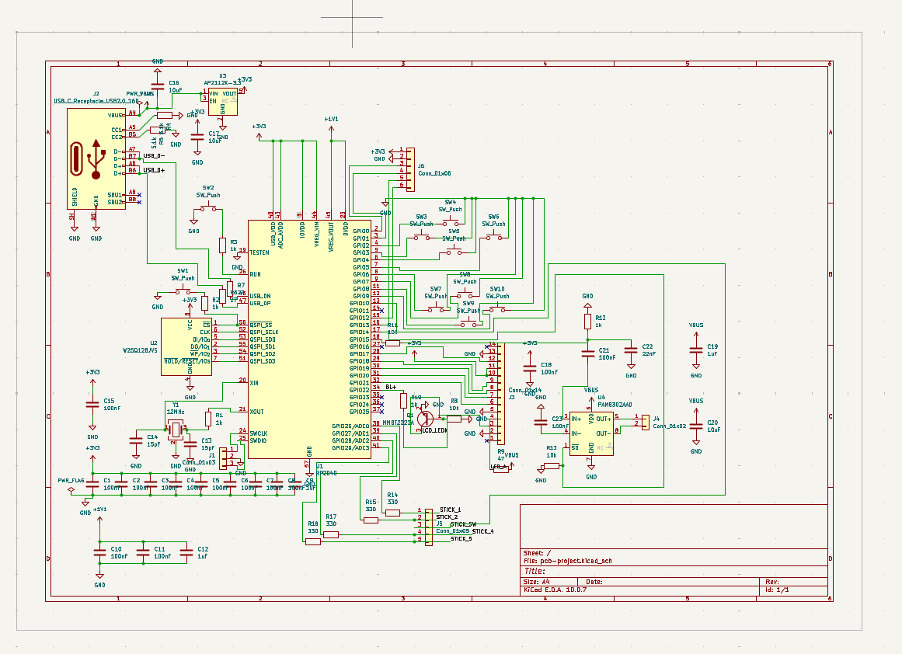
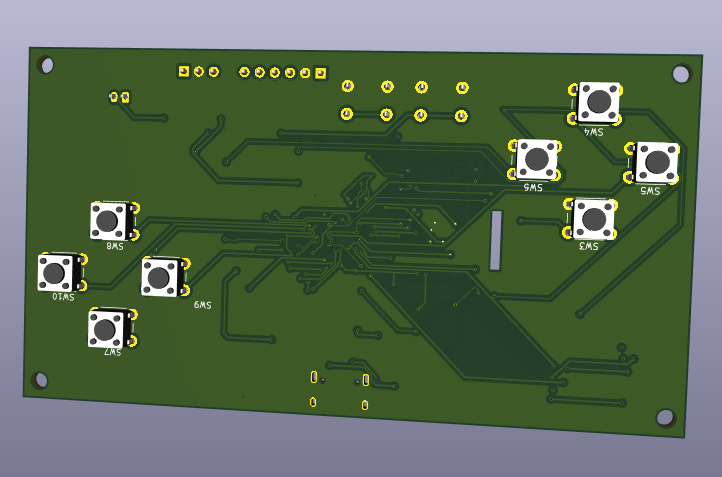
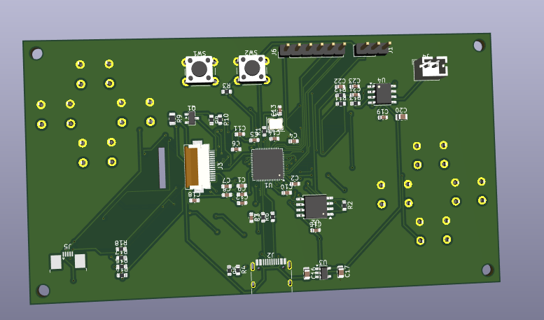
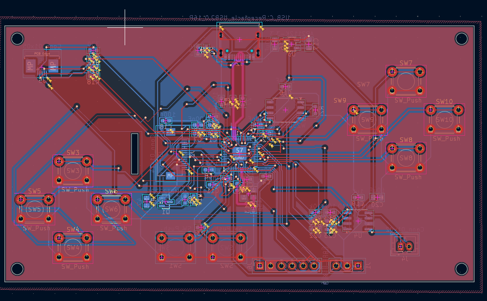

# RP2040 Chip

A nintendo switch inspired handheld game console I designed in KiCad, built around a bare RP2040 chip.

## About

This is my first PCB ever. I've done a lot of embedded stuff before (Arduino, Picos, ESP chips) and I built an 8-bit breadboard computer, but everything I've made was on breadboards and protoboards. I had never opened PCB software before this.

The idea came from a handheld I made with an ESP32 and a capacitive touch TFT (my reddit post a year ago: https://www.reddit.com/r/arduino/comments/1r4qdw3/breakout_game_with_tft_and_arduino/). I wanted to build something like that again, but with everything on one board, so the RP2040 goes straight on the PCB. I picked the RP2040 because it's cheap, it's fast-ish, and I've used it a bunch.

Made for Hack Club Half Life (week 1).

## Features

- RP2040 with 16MB of flash (W25Q128) and a 12MHz crystal
- 2.0" 240x320 IPS display (ST7789, SPI) on a 14 pin ribbon connector
- 8 buttons for controls, plus boot and reset buttons
- Joy-Con style analog thumbstick
- Speaker with a PAM8302A amp (PWM audio)
- USB-C for power and programming (no battery)
- 3 pin debug header in case USB doesn't work on my first board
- 6 pin expansion header with serial and I2C for add-ons later, like a gyro
- 110 x 60mm, 2 layer board with a ground fill on both sides

## Pictures

| Front | Back |
|---|---|
|  |  |

PCB:

Schematic:

All the SMD parts are on the back and the front only has the buttons. There's a slot cut in the board so the display ribbon can go through to its connector on the back.

## How it works

**Power:** USB-C gives 5V and an AP2112K regulator turns it into 3.3V for the chip, flash and display. The 5.1k resistors on the CC pins make chargers see the board as a device.

**Display:** SPI on GPIO17 to GPIO21. The backlight runs off 5V through a 47 ohm resistor and an NPN transistor, switched by GPIO22.

**Buttons:** Each one connects its pin to ground, and the firmware uses the RP2040's internal pull-ups.

**Thumbstick:** The stick has no datasheet, so all 4 outer ribbon pins go to GPIO26 to GPIO29 (the ADC pins) through 330 ohm resistors. The firmware picks which ones are power, ground, X and Y. The click goes to GPIO10.

**Sound:** GPIO15 makes a PWM signal, a 10k/1k divider shrinks it, and a 22nF cap filters it before it goes into the PAM8302A. GPIO14 turns the amp on.

## Pin map

| Pin | What it does |
|---|---|
| GPIO0, GPIO1 | Expansion header (serial) |
| GPIO2 to GPIO9 | The 8 buttons |
| GPIO10 | Thumbstick click |
| GPIO12, GPIO13 | Expansion header (I2C) |
| GPIO14 | Amp on/off |
| GPIO15 | Audio (PWM) |
| GPIO17 to GPIO21 | Display (SPI) |
| GPIO22 | Backlight |
| GPIO26 to GPIO29 | Thumbstick |
| SWCLK, SWDIO | Debug header |

## Files

- `pcb-project.kicad_sch`: schematic
- `pcb-project.kicad_pcb`: PCB
- `gerbers/` and `gerbers.zip`: files to send to JLCPCB
- `firmware/`: code
- `bom.csv` and `BOM.md`: parts list
- `JOURNAL.md`: my journal (synced from Half Life)

## BOM

The full list is in `BOM.md` and `bom.csv`. Parts are about $29, and about $64 with tax and shipping (estimated). The board is from JLCPCB and the parts are from LCSC, Mouser and BuyDisplay. I already had the thumbstick and speaker.

## Building it
1. Order the board from JLCPCB with `gerbers.zip` (default settings, 2 layers, tented vias)
2. Solder the SMD parts on the back. There are pads under for hotplate use. 
3. Solder the buttons, headers and speaker connector with an iron.
4. Put the display ribbon through the slot, then plug in the thumbstick and speaker.
5. Hold BOOT, plug in USB-C, and drag the firmware onto the drive that shows up.

## Future plans!

The design is done. DRC shows 0 unconnected items, and 2 cosmetic errors. I did this last minute but if I had more time I would use a 40 pin tft instead of a 14 pin one. 

## What I learned

1. KiCad from scratch: schematic, footprints, ERC, placement, routing, DRC and gerbers
2. Everything a bare RP2040 needs to boot: flash, crystal, decoupling caps and USB resistors
3. How vias actually work (they're holes in the board, not a color swap)
4. The autorouter is a scam. I used Freerouting to speed things up (and got the okay in the Half Life huddle), but it left 27 connections it couldn't do and a mess of vias. I routed all 27 connections of those by hand, and next time I'm routing everything by hand.
